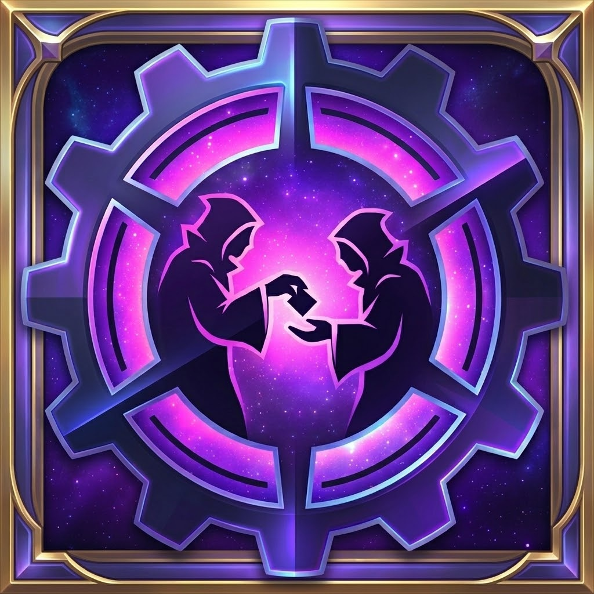

# ZipTrix (Retail / Midnight)

<p align="center">
  
</p>

## Overview
**ZipTrix** is a comprehensive World of Warcraft quality-of-life and UI customization suite designed for **Retail World of Warcraft (*Midnight* 12.0 / 12.1+ Client)**. It combines custom interface theming, unit frame class-spec gradients, tooltip customization, a Dungeon/Delve Gateways & Portals hub, spec-specific Gear Preferences, Item Upgrade Clarity, Delves utilities, Secrets tracking, and SharedMedia fonts into one cohesive addon.

---

## Installation Instructions

### Option 1: Easy Install (For Regular Users)
If you just want to play the game with the addon, follow these simple steps:

1. Click the **Code** button (green button near the top right of this page) and select **Download ZIP**.
2. Extract the downloaded ZIP file.
3. Rename the extracted folder from `ZipTrix-main` to **`ZipTrix`**.
4. Move this folder into your World of Warcraft Retail AddOns directory:
   `...\World of Warcraft\_retail_\Interface\AddOns\`
5. Start the game, ensure the addon is enabled, and enjoy!

### Option 2: Clone (For Advanced Users)
If you prefer to use Git to clone the repository directly into your AddOns folder:

Open your terminal or command prompt inside your AddOns folder (`...\World of Warcraft\_retail_\Interface\AddOns\`) and run:
```bash
git clone https://github.com/nxpxn/ZipTrix.git
```

---

## Primary Features
- **Gateways & Portals Hub (`WorldMapDungeonPortals`):**
  - Provides quick one-click access to **Mythic+ Hero's Path Dungeon Teleports**, **Hearthstones**, **Engineering Wormhole Generators**, and teleport toys/items across expansions (updated for *Midnight* 12.0 / 12.1).
  - **Dynamic Dungeon & Delve Escape Section:** Automatically appears at the top of the Gateways tab whenever you are inside a dungeon or delve, offering instant access to *Delver's Mana-Bound Ethergate*, *Delve-O-Bot 7001*, the active dungeon's entrance teleport, *Direbrew's Remote*, and *Jaina's Locket*.
  - **Smart Profession Filtering:** Profession-restricted teleports (Engineering, Fishing) only appear on characters who have learned that profession.
- **Gear Preferences & Character Sheet Enhancements (`GearPrefs`):**
  - Adds a dedicated **Gear Preferences** tab to the Character Pane displaying spec-specific Best-in-Slot **Gems**, **Enchants**, **Consumables**, Hunter Scopes, and DK Runeforges dynamically powered by `ClassCodexGearData`.
  - Enhances the default Character Stats pane with inline **Stat Ratings**, **Percentages**, and **Diminishing Returns (DR)** threshold indicators.
- **UI Themes, Unit Frames & Character Customization:**
  - **Global Themes & Borders:** Customize tooltips, dropdowns, and UI buttons with themes including `Dark`, `Expansion` (Toxic Green), `Class`, `DarkMode (Integrade)`, or `Blizzard`.
  - **Class-Spec Health Bar Gradients:** Dynamic specialization color gradients for Player, Target, Party, Raid (`CompactUnitFrames`), and Class Resource bars.
  - **Custom Character Sheet Portraits:** Replace your character sheet portrait with stylized class emblems (`Fabled`, `Core`, `Myth`, `Realm`, `Void`, or `Hidden`—right-click the portrait to cycle).
  - **Bag & Queue Visuals:** Openable container/cache glow in bags matching your active theme, plus LFG Queue Eye cursor tracking.
- **Tooltip Customization:**
  - Cursor anchoring, custom NineSlice-safe border styling, optional combat hiding, unit health bar hiding, and automatic **Item ID** and **Spell ID** display.
- **Upgrade Clarity (`UpgradeClarity`):**
  - Displays clear item upgrade track and step scaling information for current season and *Midnight* gear tracks, plus vendor upgrade and uncollected transmog indicators.
- **Delves & Secrets Helpers (`Delves` / Secrets):**
  - **Delves Module:** Dedicated Delves configuration tab with **Mislaid Curiosities** tracking.
  - **Secrets Helper:** Built-in progress tracker and one-click waypoint generator for World of Warcraft secrets (*Mind-Seeker*, *Baa'l*, *Waist of Time*, *Otto*, and more).
- **Class Utilities & Quality of Life (`EverythingElse` / `Druidism`):**
  - **Class Macro Generators & Bars:** One-click Travel, Utility, and Interrupt macro generators for **Shaman**, **Paladin**, and **Druid**, plus a movable/resizable **Shaman Maelstrom Weapon** resource bar (1–10 stacks).
  - **Cleanup & Wardrobe Utilities:** Duplicate **Macro Clean Up** tool, **Tracker Cleanup** (untrack all quests/achievements), **Unlock Blizzard Frames** helper, and **Wardrobe Outfit Icon Search** (by Icon ID, Spell ID/Name, or Item ID/Name).
- **Shared Media Fonts:**
  - Automatically registers a curated collection of custom fonts with `LibSharedMedia-3.0` (*Atkinson Hyperlegible Next*, *Expressway*, *SF Atarian System*, *Zilla Slab*, *Epic Fusion*, and *D&D Fonts*).

## Configuration
You can access the **ZipTrix** configuration window via the **Addon Compartment** button (minimap header), the standard World of Warcraft **Options -> AddOns** menu, or the **Gear Preferences** tab on your Character Sheet. Detailed module changelogs are available in `CHANGES.TXT`.
